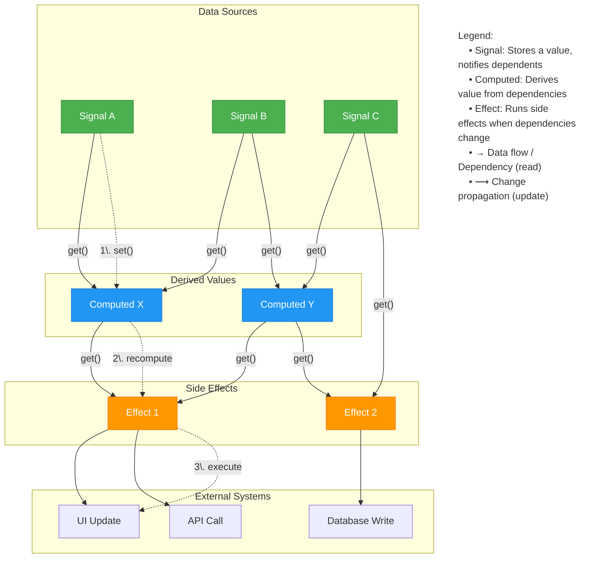
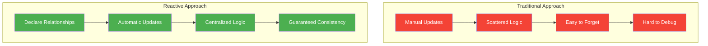

# reaktiv

<div align="center">


 [](https://pypi.org/project/reaktiv/) [](https://pepy.tech/projects/reaktiv)   [](https://microsoft.github.io/pyright/)

[](https://ko-fi.com/H2H71OBINS)

**Reactive Declarative State Management Library for Python** - automatic dependency tracking and reactive updates for your application state.

[Website](https://reaktiv.bui.app/) | [Live Playground](https://reaktiv.bui.app/#playground) | [Documentation](https://reaktiv.bui.app/docs) | [Deep Dive Article](https://bui.app/the-missing-manual-for-signals-state-management-for-python-developers/)

</div>

## Installation

```bash
pip install reaktiv
# or with uv
uv pip install reaktiv
```

`reaktiv` is a **reactive declarative state management library** that lets you **declare relationships between your data** instead of manually managing updates. When data changes, everything that depends on it updates automatically - eliminating a whole class of bugs where you forget to update dependent state.

**Think of it like Excel spreadsheets for your Python code**: when you change a cell value, all formulas that depend on it automatically recalculate. That's exactly how `reaktiv` works with your application state.

**Key benefits:**
- 🐛 **Fewer bugs**: No more forgotten state updates or inconsistent data
- 📋 **Clearer code**: State relationships are explicit and centralized
- ⚡ **Better performance**: Only recalculates what actually changed (fine-grained reactivity)
- 🔄 **Automatic updates**: Dependencies are tracked and updated automatically
- 🎯 **Python-native**: Built for Python's patterns with full async support
- 🧩 **Application-ready models**: Group state, derived values, effects, resources, and cleanup
- 🔒 **Type safe**: Full type hint support with automatic inference
- 🚀 **Lazy evaluation**: Computed values are only calculated when needed
- 💾 **Smart memoization**: Results are cached and only recalculated when dependencies change

## Documentation

Full documentation is available at [https://reaktiv.bui.app/](https://reaktiv.bui.app/).

For a comprehensive guide, check out [The Missing Manual for Signals: State Management for Python Developers](https://bui.app/the-missing-manual-for-signals-state-management-for-python-developers/).

**Using a coding agent?** reaktiv ships a short guide for AI coding agents, matching the installed version, at `reaktiv/AGENTS.md` inside the package (also [online](https://reaktiv.bui.app/docs/agents/)). Point your project's `AGENTS.md` or `CLAUDE.md` at it so the agent writes declarative, reactive code. An index for agents is at [`llms.txt`](https://reaktiv.bui.app/docs/llms.txt).

## Quick Start

```python
from reaktiv import computed, effect, signal

# Your reactive data sources
name = signal("Alice")
age = signal(30)

# Reactive derived data - automatically stays in sync
@computed
def greeting():
    return f"Hello, {name()}! You are {age()} years old."

# Reactive side effects - automatically run when data changes
# IMPORTANT: Must assign to variable to prevent garbage collection
def print_greeting():
    print(f"Updated: {greeting()}")

greeting_effect = effect(print_greeting)

# Just change your base data - everything reacts automatically
name.set("Bob")  # Prints: "Updated: Hello, Bob! You are 30 years old."
age.set(31)      # Prints: "Updated: Hello, Bob! You are 31 years old."
```

Use lowercase primitives in new code: `signal(...)`, `computed(...)`,
`linked(...)`, `resource(...)`, and `effect(...)`. Uppercase names such as
`Signal`, `ComputeSignal`, `LinkedSignal`, `Resource`, and `Effect` are the
concrete classes or compatibility entry points you may see in API references
and older examples.

## Core Concepts

`reaktiv` provides three simple building blocks for reactive programming - just like Excel has cells and formulas:

1. **signal**: Holds a reactive value that can change (like an Excel cell with a value)
2. **computed**: Automatically derives a reactive value from other signals/computed values (like an Excel formula)
3. **effect**: Runs reactive side effects when signals/computed values change (like Excel charts that update when data changes)

```python
from reaktiv import computed, effect, signal

# signal: wraps a reactive value (like Excel cell A1 = 5)
counter = signal(0)

# computed: derives from other reactive values (like Excel cell B1 = A1 * 2)
@computed
def doubled():
    return counter() * 2

# effect: reactive side effects (like Excel chart that updates when cells change)
def print_values():
    print(f"Counter: {counter()}, Doubled: {doubled()}")

counter_effect = effect(print_values)

counter.set(5)  # Reactive update: prints "Counter: 5, Doubled: 10"
```

### Excel Spreadsheet Analogy

If you've ever used Excel, you already understand reactive programming:

| Cell | Value/Formula | reaktiv Equivalent |
|------|---------------|-------------------|
| A1   | `5`           | `signal(5)`       |
| B1   | `=A1 * 2`     | `@computed def b1(): ...` |
| C1   | `=A1 + B1`    | `@computed def c1(): ...` |

When you change A1 in Excel, B1 and C1 automatically recalculate. That's exactly what happens with reaktiv:

```python
# Excel-style reactive programming in Python
from reaktiv import computed, effect, signal

a1 = signal(5)  # A1 = 5

@computed  # B1 = A1 * 2
def b1() -> int:
    return a1() * 2

@computed  # C1 = A1 + B1
def c1() -> int:
    return a1() + b1()

# Display effect (like Excel showing the values)
def display_cells():
    print(f"A1={a1()}, B1={b1()}, C1={c1()}")

display_effect = effect(display_cells)

a1.set(10)  # Change A1 - everything recalculates automatically!
# Prints: A1=10, B1=20, C1=30
```

Just like in Excel, you don't need to manually update B1 and C1 when A1 changes - the dependency tracking handles it automatically.



### Additional Features That reaktiv Provides

**Lazy Evaluation** - Computations only happen when results are actually needed:
```python
# This expensive computation isn't calculated until you access it
@computed
def expensive_calc():
    return sum(range(1000000))  # Not calculated yet!

print(expensive_calc())  # NOW it calculates when you need the result
print(expensive_calc())  # Instant! (cached result)
```

**Memoization** - Results are cached until dependencies change:
```python
# Results are automatically cached for efficiency
a1 = signal(5)

@computed
def b1():
    return a1() * 2  # Define the computation

result1 = b1()  # Calculates: 5 * 2 = 10
result2 = b1()  # Cached! No recalculation needed

a1.set(6)       # Dependency changed - cache invalidated
result3 = b1()  # Recalculates: 6 * 2 = 12
```

**Fine-Grained Reactivity** - Only affected computations recalculate:
```python
# Independent data sources don't affect each other
a1 = signal(5)    # Independent signal
d2 = signal(100)  # Another independent signal

@computed  # Depends only on a1
def b1():
    return a1() * 2

@computed  # Depends on a1 and b1
def c1():
    return a1() + b1()

@computed  # Depends only on d2
def e2():
    return d2() / 10

a1.set(10)  # Only b1 and c1 recalculate, e2 stays cached
d2.set(200) # Only e2 recalculates, b1 and c1 stay cached
```

This intelligent updating means your application only recalculates what actually needs to be updated, making it highly efficient.

## The Problem This Solves

Consider a simple order calculation:

### Without reaktiv (Manual Updates)
```python
class Order:
    def __init__(self):
        self.price = 100.0
        self.quantity = 2
        self.tax_rate = 0.1
        self._update_totals()  # Must remember to call this

    def set_price(self, price):
        self.price = price
        self._update_totals()  # Must remember to call this

    def set_quantity(self, quantity):
        self.quantity = quantity
        self._update_totals()  # Must remember to call this

    def _update_totals(self):
        # Must update in the correct order
        self.subtotal = self.price * self.quantity
        self.tax = self.subtotal * self.tax_rate
        self.total = self.subtotal + self.tax
        # Oops, forgot to update the display!
```

### With reaktiv (Excel-style Automatic Updates)
This is like Excel - change a cell and everything recalculates automatically:

```python
from reaktiv import signal, computed, effect

# Base values (like Excel input cells)
price = signal(100.0)      # A1
quantity = signal(2)       # A2
tax_rate = signal(0.1)     # A3

# Formulas (like Excel computed cells)
@computed  # B1 = A1 * A2
def subtotal():
    return price() * quantity()

@computed  # B2 = B1 * A3
def tax():
    return subtotal() * tax_rate()

@computed  # B3 = B1 + B2
def total():
    return subtotal() + tax()

# Auto-display (like Excel chart that updates automatically)
def print_total():
    print(f"Order total: ${total():.2f}")

total_effect = effect(print_total)

# Just change the input - everything recalculates like Excel!
price.set(120.0)  # Change A1 - B1, B2, B3 all update automatically
quantity.set(3)      # Same thing
```

Benefits:
- ✅ Cannot forget to update dependent data
- ✅ Updates always happen in the correct order
- ✅ State relationships are explicit and centralized
- ✅ Side effects are guaranteed to run

## Type Safety & Decorator Benefits

`reaktiv` provides full type hint support, making it compatible with static type checkers like ruff, mypy and pyright. This enables better IDE autocompletion, early error detection, and improved code maintainability.

```python
from reaktiv import signal, computed, effect

# Type inference works automatically
name = signal("Alice")
age = signal(30)
active = signal(True)
score = signal(100.0)
items = signal([1, 2, 3])

# Computed values preserve and infer types
@computed
def name_length():
    return len(name())

@computed
def greeting():
    return f"Hello, {name()}!"

@computed
def total_score():
    return score() * 1.5

# Type-safe update functions
def increment_age(current: int) -> int:
    return current + 1

age.update(increment_age)  # Type checked!
```

## ReactiveModel For Application State

`ReactiveModel` groups a related signal graph into a reusable Python object.
Each model instance owns independent fields, derived values, effects, and async
resources.

- `field(...)` declares per-instance writable signals.
- `@computed` derives cached values.
- `@linked` creates editable derived state.
- `@effect` runs model-owned side effects.
- `@resource` loads asynchronous data from reactive parameters.
- `dispose()` cleans up all effects and resources owned by the instance.

```python
from reaktiv import ReactiveModel, computed, effect, field


class ShoppingCart(ReactiveModel):
    unit_price = field(12.50)
    quantity = field(1)
    discount = field(0.0)

    @computed
    def subtotal(self) -> float:
        return self.unit_price() * self.quantity()

    @computed
    def total(self) -> float:
        return self.subtotal() * (1 - self.discount())

    @effect
    def show_total(self) -> None:
        print(f"{self.quantity()} item(s): ${self.total():.2f}")


cart = ShoppingCart()       # Prints: 1 item(s): $12.50
cart.quantity.set(3)        # Prints: 3 item(s): $37.50
cart.discount.set(0.10)     # Prints: 3 item(s): $33.75

cart.dispose()
```

Each declared field creates a separate writable signal for every model instance. Use a
factory for mutable defaults and `field[T]` when the intended type is not clear
from the value:

```python
from typing import Optional


class SearchModel(ReactiveModel):
    query = field("")
    selected_id = field[Optional[str]](None)
    history = field[list[str]](factory=list)
```

Read the [ReactiveModel API guide](https://reaktiv.bui.app/docs/api/reactive-model/)
for fields, typing, linked state, async resources, cleanup, inheritance, and
mixin patterns. Complete examples:

- [`reactive_model_cart.py`](examples/reactive_model_cart.py)
- [`reactive_model_linked_resource.py`](examples/reactive_model_linked_resource.py)

## Why This Pattern?



This reactive approach comes from frontend frameworks like **Angular** and **SolidJS**, where fine-grained reactivity revolutionized UI development. While those frameworks use this reactive pattern to efficiently update user interfaces, the core insight applies everywhere: **declaring reactive relationships between data leads to fewer bugs** than manually managing updates.

The reactive pattern is particularly valuable in Python applications for:
- Configuration management with cascading overrides
- Caching with automatic invalidation
- Real-time data processing pipelines
- Request/response processing with derived context
- Monitoring and alerting systems

## Practical Examples

### Reactive Configuration Management
```python
from reaktiv import signal, computed

# Multiple reactive config sources
defaults = signal({"timeout": 30, "retries": 3})
user_prefs = signal({"timeout": 60})
feature_flags = signal({"new_retry_logic": True})

# Automatically reactive merged config
@computed
def config():
    return {
        **defaults(),
        **user_prefs(),
        **feature_flags()
    }

print(config())  # {'timeout': 60, 'retries': 3, 'new_retry_logic': True}

# Change any source - merged config reacts automatically
defaults.update(lambda d: {**d, "max_connections": 100})
print(config())  # Now includes max_connections
```

### Reactive Data Processing Pipeline
```python
import time
from reaktiv import signal, computed, effect

# Reactive raw data stream
raw_data = signal([])

# Reactive processing pipeline
@computed
def filtered_data():
    return [x for x in raw_data() if x > 0]

@computed
def processed_data():
    return [x * 2 for x in filtered_data()]

@computed
def summary():
    data = processed_data()
    return {
        "count": len(data),
        "sum": sum(data),
        "avg": sum(data) / len(data) if data else 0
    }

# Reactive monitoring - MUST assign to variable!
def print_summary():
    print(f"Summary: {summary()}")

summary_effect = effect(print_summary)

# Add data - entire reactive pipeline recalculates automatically
raw_data.set([1, -2, 3, 4])  # Prints summary
raw_data.update(lambda d: d + [5, 6])  # Updates summary
```

#### Reactive Pipeline Visualization

```mermaid
graph LR
    subgraph "Reactive Data Processing Pipeline"
        RD[raw_data<br/>Signal&lt;list&gt;]
        FD[filtered_data<br/>Computed&lt;list&gt;]
        PD[processed_data<br/>Computed&lt;list&gt;]
        SUM[summary<br/>Computed&lt;dict&gt;]

        RD -->|reactive filter x > 0| FD
        FD -->|reactive map x * 2| PD
        PD -->|reactive aggregate| SUM

        SUM --> EFF[Effect: print summary]
    end

    NEW[New Data] -.->|"raw_data.set()"| RD
    RD -.->|reactive update| FD
    FD -.->|reactive update| PD
    PD -.->|reactive update| SUM
    SUM -.->|reactive trigger| EFF

    classDef signal fill:#4CAF50,color:white
    classDef computed fill:#2196F3,color:white
    classDef effect fill:#FF9800,color:white
    classDef input fill:#9C27B0,color:white

    class RD signal
    class FD,PD,SUM computed
    class EFF effect
    class NEW input
```



### Reactive System Monitoring
```python
from reaktiv import signal, computed, effect

# Reactive system metrics
cpu_usage = signal(20)
memory_usage = signal(60)
disk_usage = signal(80)

@computed
def system_health():
    metrics = [cpu_usage(), memory_usage(), disk_usage()]
    if any(value > 90 for value in metrics):
        return "critical"
    if any(value > 75 for value in metrics):
        return "warning"
    return "healthy"

# Reactive automatic alerting - MUST assign to variable!
def print_alert():
    if system_health() != "healthy":
        print(f"System status: {system_health()}")

alert_effect = effect(print_alert)

cpu_usage.set(95)  # Reactive system automatically prints: "System status: critical"
```

## Advanced Features

### linked (Writable Derived State)

`linked` creates writable derived state that can be manually set by users but
automatically resets when its source context changes. Use it for “user
overrides with sane defaults” that should survive some changes but reset on
others.

Common use cases:
- Pagination: selection resets when page changes
- Wizard flows: step-specific state resets when the step changes
- Filters & search: user-picked value persists across pagination, resets when query changes
- Forms: default values computed from context but user can override temporarily

**Using the @linked decorator:**

```python
from reaktiv import signal, linked

page = signal(1)

# Writable derived state that resets whenever page changes
@linked
def selection() -> str:
    return f"default-for-page-{page()}"

selection.set("custom-choice")   # user override
print(selection())                # "custom-choice"

page.set(2)                       # context changes → resets
print(selection())                # "default-for-page-2"
```

**Alternative: factory function style:**
```python
selection = linked(lambda: f"default-for-page-{page()}")
```

Advanced pattern (explicit source and previous-state aware computation):

```python
from reaktiv import linked, signal, PreviousState

# Source contains (query, page). We want selection to persist across page changes
# but reset when the query string changes.
query = signal("shoes")
page = signal(1)

def compute_selection(src: tuple[str, int], prev: PreviousState[tuple[str, int], str] | None) -> str:
    current_query, _ = src
    # If only the page changed, keep previous selection
    if prev is not None and prev.source[0] == current_query:
        return prev.value
    # Otherwise, provide a new default for the new query
    return f"default-for-{current_query}"

selection = linked(source=lambda: (query(), page()), computation=compute_selection)

print(selection())  # "default-for-shoes"
selection.set("red-sneakers")

page.set(2)         # page changed, same query → keep user override
print(selection())  # "red-sneakers"

query.set("boots")  # query changed → reset to new default
print(selection())  # "default-for-boots"
```

Notes:
- It’s writable: call `selection.set(...)` or `selection.update(...)` to override.
- It auto-resets based on the dependencies you read (simple pattern) or your custom `source` logic (advanced pattern).

### resource - Async Data Loading

`resource` brings async operations into your reactive application with automatic
dependency tracking, request cancellation, and comprehensive status management.
Perfect for API calls and data fetching.

```python
import asyncio
from reaktiv import resource, signal, ResourceStatus

# Reactive parameter
user_id = signal(1)

# Async data loader
async def fetch_user(params):
    # Check for cancellation
    if params.cancellation.is_set():
        return None

    await asyncio.sleep(0.5)  # Simulate API call
    return {"id": params.params["user_id"], "name": f"User {params.params['user_id']}"}

async def main():
    # Create resource
    user_resource = resource(
        params=lambda: {"user_id": user_id()},  # When user_id changes, auto-reload
        loader=fetch_user
    )

    # Wait for initial load
    await asyncio.sleep(0.6)

    # Access data safely
    if user_resource.has_value():
        print(user_resource.value())  # {"id": 1, "name": "User 1"}

    # Changing param automatically triggers reload
    user_id.set(2)
    await asyncio.sleep(0.6)
    print(user_resource.value())  # {"id": 2, "name": "User 2"}

asyncio.run(main())
```

**Key features:**
- **6 status states**: IDLE, LOADING, RELOADING, RESOLVED, ERROR, LOCAL
- **Automatic request cancellation** when parameters change (prevents race conditions)
- **Seamless integration** with `computed` and `effect`
- **Manual control** via `reload()`, `set()`, and `update()` methods
- **Atomic snapshots** for safe state access
- **Automatic cleanup** when garbage collected


For complete documentation, examples, and design patterns, see the [Resource User Guide](https://reaktiv.bui.app/docs/resource-guide.html).

### Custom Equality

Model fields and async resource values also accept `equal=` callbacks:

```python
amount = field(1.0, equal=lambda previous, current: abs(previous - current) < 0.01)
loaded = resource(params=get_params, loader=load_data, equal=compare_results)
```

Returning `True` retains the previous value and skips value-change notifications.
Resource equality applies to loaded or manually set values, independently of
request parameters and loading/error status.
```python
# For objects where you want value-based comparison
items = signal([1, 2, 3], equal=lambda a, b: a == b)
items.set([1, 2, 3])  # Won't trigger updates (same values)
```

### Update Functions
```python
counter = signal(0)
counter.update(lambda x: x + 1)  # Increment based on current value
```

### Async Effects

**Recommendation: Use synchronous effects** - they provide better control and predictable behavior:

```python
import asyncio

my_signal = signal("initial")

# ✅ RECOMMENDED: Synchronous effect with async task spawning
def sync_effect():
    # Signal values captured at this moment - guaranteed consistency
    current_value = my_signal()

    # Spawn async task if needed
    async def background_work():
        await asyncio.sleep(0.1)
        print(f"Processing: {current_value}")

    asyncio.create_task(background_work())

# MUST assign to variable!
my_effect = effect(sync_effect)
```

**Experimental: Direct async effects**

Async effects are experimental and should be used with caution:

```python
import asyncio

async def async_effect():
    await asyncio.sleep(0.1)
    print(f"Async processing: {my_signal()}")

# MUST assign to variable!
my_async_effect = effect(async_effect)
```

**Key differences:**
- **Synchronous effects**: Block the signal update until complete, ensuring signal values don't change during effect execution
- **Async effects** (experimental): Allow signal updates to complete immediately, but signal values may change while the async effect is running

**Note:** Most applications should use synchronous effects for predictable behavior.

### Untracked Reads
Use `untracked()` to read signals without creating dependencies:

```python
from reaktiv import signal, computed, effect

user_id = signal(1)
debug_mode = signal(False)

# This computed only depends on user_id, not debug_mode
def get_user_data():
    uid = user_id()  # Creates dependency
    if untracked(debug_mode):  # No dependency created
        print(f"Loading user {uid}")
    return f"User data for {uid}"

user_data = computed(get_user_data)

debug_mode.set(True)   # Won't trigger recomputation
user_id.set(2)         # Will trigger recomputation
```

**Context Manager Usage**

You can also use `untracked` as a context manager to read multiple signals without creating dependencies. This is useful for logging or conditional logic inside an effect without adding extra dependencies.

```python
from reaktiv import signal, computed, effect, untracked

name = signal("Alice")
is_logging_enabled = signal(False)
log_level = signal("INFO")

@computed
def greeting():
    return f"Hello, {name()}!"

# An effect that depends on `greeting`, but reads other signals untracked
def display_greeting():
    # Create a dependency on `greeting`
    current_greeting = greeting()

    # Read multiple signals without creating dependencies
    with untracked():
        logging_active = is_logging_enabled()
        current_log_level = log_level()
        if logging_active:
            print(f"LOG [{current_log_level}]: Greeting updated to '{current_greeting}'")

    print(current_greeting)

# MUST assign to variable!
greeting_effect = effect(display_greeting)
# Initial run prints: "Hello, Alice"

name.set("Bob")
# Prints: "Hello, Bob"

is_logging_enabled.set(True)
log_level.set("DEBUG")
# Prints nothing, because these are not dependencies of the effect.

name.set("Charlie")
# Prints:
# LOG [DEBUG]: Greeting updated to 'Hello, Charlie'
# Hello, Charlie
```

The context manager approach is particularly useful when you need to read multiple signals for logging, debugging, or conditional logic without creating reactive dependencies.

### Batch Updates
Use `batch()` to group multiple updates and trigger effects only once:

```python
from reaktiv import signal, effect, batch

name = signal("Alice")
age = signal(30)
city = signal("New York")

def print_info():
    print(f"{name()}, {age()}, {city()}")

info_effect = effect(print_info)
# Effect prints one time on init

# Without batch - prints 3 times
name.set("Bob")
age.set(25)
city.set("Boston")

# With batch - prints only once at the end
with batch():
    name.set("Charlie")
    age.set(35)
    city.set("Chicago")
# Only prints once: "Charlie, 35, Chicago"
```

### Error Handling

Proper error handling is crucial to prevent cascading failures:

```python
from reaktiv import signal, computed, effect

# Example: Division computation that can fail
numerator = signal(10)
denominator = signal(2)

# Unsafe computation - can throw ZeroDivisionError
@computed
def unsafe_division():
    return numerator() / denominator()

# Safe computation with error handling
def safe_divide():
    try:
        return numerator() / denominator()
    except ZeroDivisionError:
        return float('inf')  # or return 0, or handle as needed

safe_division = computed(safe_divide)

# Error handling in effects
def safe_print():
    try:
        unsafe_result = unsafe_division()
        print(f"Unsafe result: {unsafe_result}")
    except ZeroDivisionError:
        print("Error: Division by zero!")

    safe_result = safe_division()
    print(f"Safe result: {safe_result}")

effect = effect(safe_print)

# Test error scenarios
denominator.set(0)  # Triggers ZeroDivisionError in unsafe computation
# Prints: "Error: Division by zero!" and "Safe result: inf"
```

## Important Notes

### ⚠️ Effect Retention (Critical!)
**Effects must be assigned to a variable to prevent garbage collection.** This is the most common mistake when using reaktiv:

```python
# ❌ WRONG - effect gets garbage collected immediately and won't work
def print_wrong():
    print("This will never print")

effect(print_wrong)

# ✅ CORRECT - effect stays active
def print_right():
    print("This works!")

my_effect = effect(print_right)

# ✅ Also correct - store in a list or class attribute
effects = []

def print_from_list():
    print("This also works!")

effects.append(effect(print_from_list))

# ✅ In classes, assign to self
class MyClass:
    def __init__(self):
        self.counter = signal(0)
        # Keep effect alive by assigning to instance
        self.effect = effect(self.print_counter)

    def print_counter(self):
        print(f"Counter: {self.counter()}")
```

**Why this design?** This explicit retention requirement prevents accidental memory leaks. Unlike some reactive systems that automatically keep effects alive indefinitely, `reaktiv` requires you to explicitly manage effect lifetimes. When you no longer need an effect, simply let the variable go out of scope or delete it - the effect will be automatically cleaned up. This gives you control over when reactive behavior starts and stops, preventing long-lived applications from accumulating abandoned effects.

**Manual cleanup:** You can also explicitly dispose of effects when you're done with them:

```python
def print_value():
    print("This will run")

my_effect = effect(print_value)
# ... some time later ...
my_effect.dispose()  # Manually clean up the effect
# Effect will no longer run when dependencies change
```

### Mutable Objects
By default, reaktiv uses identity comparison. For mutable objects:

```python
data = signal([1, 2, 3])

# This triggers update (new list object)
data.set([1, 2, 3])

# This doesn't trigger update (same object, modified in place)
current = data()
current.append(4)  # reaktiv doesn't see this change
```

### Working with Lists and Dictionaries

When working with mutable objects like lists and dictionaries, you need to create new objects to trigger updates:

#### Lists
```python
items = signal([1, 2, 3])

# ❌ WRONG - modifies in place, no update triggered
current = items()
current.append(4)  # reaktiv doesn't detect this

# ✅ CORRECT - create new list
items.set([*items(), 4])  # or items.set(items() + [4])

# ✅ CORRECT - using update() method
items.update(lambda current: current + [4])
items.update(lambda current: [*current, 4])

# Other list operations
items.update(lambda lst: [x for x in lst if x > 2])  # Filter
items.update(lambda lst: [x * 2 for x in lst])       # Map
items.update(lambda lst: lst[:-1])                   # Remove last
items.update(lambda lst: [0] + lst)                  # Prepend
```

#### Dictionaries
```python
config = signal({"timeout": 30, "retries": 3})

# ❌ WRONG - modifies in place, no update triggered
current = config()
current["new_key"] = "value"  # reaktiv doesn't detect this

# ✅ CORRECT - create new dictionary
config.set({**config(), "new_key": "value"})

# ✅ CORRECT - using update() method
config.update(lambda current: {**current, "new_key": "value"})

# Other dictionary operations
config.update(lambda d: {**d, "timeout": 60})           # Update value
config.update(lambda d: {k: v for k, v in d.items() if k != "retries"})  # Remove key
config.update(lambda d: {**d, **{"max_conn": 100, "pool_size": 5}})      # Merge multiple
```

#### What `equal=` Does (and Doesn't)
Mutating a value in place is never detected, not even with a custom `equal=`:
after `current.append(4)` the signal already holds the mutated list, so the
comparison receives the same object twice. Always create a new value.

`equal=` decides whether a **new** value counts as a change. When it returns
`True`, the signal keeps its previous value and notifies nobody:

```python
items = signal([1, 2, 3], equal=lambda a, b: a == b)

items.set([1, 2, 3])                  # new list, same content: no update
items.update(lambda xs: [*xs, 4])     # new list, new content: updates

current = items()
current.append(5)
items.set(current)                    # ❌ in-place mutation: never detected
```

The same rule applies to `computed`, `linked`, model fields and resources, and
matches Angular and SolidJS: equality is checked against the last published
value, and when it reports "equal" the previous value is kept. If the function
raises, `set()` raises and the old value stays; in a computed the exception
becomes the computed's error.

## More Examples

You can find more example scripts in the [examples](./examples) folder to help you get started with using this project.

Including integration examples with:

- [FastAPI - Websocket](./examples/fastapi_websocket.py)
- [NiceGUI - Todo-App](./examples/nicegui_todo_app.py)
- [Reactive Data Pipeline with NumPy and Pandas](./examples/data_pipeline_numpy_pandas.py)
- [Jupyter Notebook - Reactive IPyWidgets](./examples/reactive_jupyter_notebook.ipynb)
- [NumPy Matplotlib - Reactive Plotting](./examples/numpy_plotting.py)
- [IoT Sensor Agent Thread - Reactive Hardware](./examples/iot_sensor_agent_thread.py)

## Star History

[](https://star-history.com/#buiapp/reaktiv&Date)

---

**Inspired by** Angular Signals and SolidJS reactivity • **Built for** Python developers who want fewer state management bugs • **Made in** Hamburg
